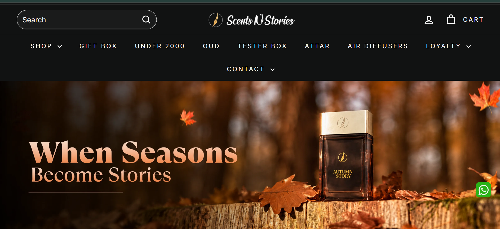

# Assignment 2 — Scents n Stories (Static, Responsive Pages)

## Reference Site
- **Name:** Scents n Stories
- **URL:** https://scentsnstories.pk
- **Screenshot:** 

## What I Built
- `index.html` — homepage with announcement bar, navbar, hero banner, responsive grid of 8 product cards, "Why Choose Us" section and footer
- `product.html` — product detail page with large image, name, price, description, quantity selector and "Add to Cart" button
- `css/style.css` — my custom styles and media queries

## Tools Used
- HTML5, CSS3
- **Bootstrap 5** (via CDN) — used for the navbar and the responsive grid (`row`, `col`, `row-cols-*`)
- Flexbox/Grid come from Bootstrap's grid system and utility classes

## Responsive Behaviour
| Screen | Width | Product cards per row |
|---|---|---|
| Phone | ~375px | 1 (hamburger menu) |
| Tablet | ~768px | 3 |
| Desktop | 992px+ | 4 (full navbar) |

## Notes
- No JavaScript yet (except Bootstrap's own script for the hamburger menu).
- "Add to Cart" buttons and the cart icon do not work yet. They will be done in Assignment 3.

## How to Run
Open the folder in VS Code and use the Live Server extension on `index.html`.